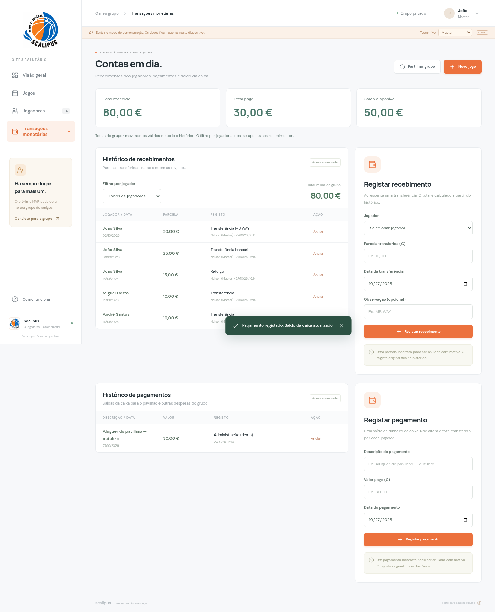
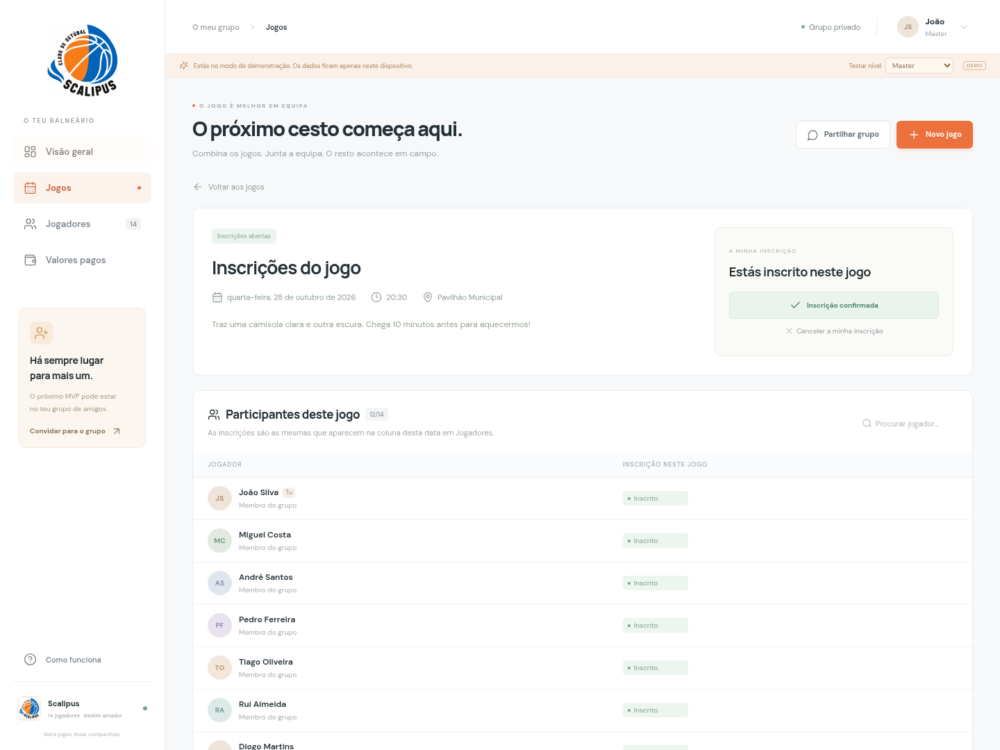

# Scalipus — transações monetárias

A tab **Transações monetárias**, exclusiva de Master e administradores, reúne:

- **Histórico de recebimentos:** transferências recebidas dos jogadores, com data, observação e autor.
- **Histórico de pagamentos:** saídas de dinheiro para o pavilhão e outras despesas, com valor, data, descrição e autor.
- **Resumo da caixa:** total recebido, total pago e saldo disponível. O filtro por jogador não altera estes totais globais.

Os movimentos incorretos podem ser anulados com motivo, sem apagar o histórico. O acumulado de cada jogador continua a somar apenas as suas transferências válidas; as despesas não o alteram. Saldos negativos são permitidos e aparecem a vermelho.

## Inscrições e participação

Abre um jogo na tab Jogos para te inscreveres ou cancelares. A lista do jogo e a grelha de Jogadores usam o mesmo registo; alterações aparecem nos dois ecrãs sem afetar outras datas. A coluna Valor pago é apenas de consulta.

O relatório de participação exclui jogos futuros. A fusão de jogadores é reservada ao Master, que pode delegar a permissão a administradores individualmente. O logótipo Scalipus está incluído.

## Descarregar

Abre Scalitpus-demo.zip e escolhe Download raw file. Extrai o ZIP e abre scalitpus-demo.html. É uma demonstração com dados fictícios e locais, sem sincronização entre dispositivos. A versão partilhada requer alojamento e Supabase.

Validação: compilação, 13 testes de domínio, 17 testes de navegador e verificações SQL de permissões, privacidade financeira e integridade. Os testes abrangem registo/anulação de despesas, saldo negativo, persistência, filtros, preservação dos totais por jogador e telemóvel.
