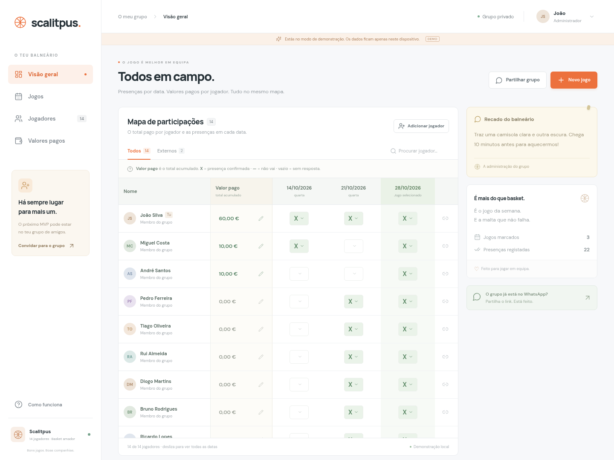

# Scalitpus — mapa de participações

A demonstração foi atualizada para o formato de grelha:

- Uma linha por jogador.
- **Valor pago:** total acumulado do jogador, editável pelo administrador.
- Uma coluna por data: **X** = presença, **—** = não vai, vazio = sem resposta.
- Os pagamentos são independentes dos jogos e das presenças; externos estão isentos.

## Descarregar

Abre `Scalitpus-demo.zip` e escolhe **Download raw file** (Descarregar ficheiro). Extrai o ZIP e abre `scalitpus-demo.html` no navegador.

Esta é uma demonstração com dados fictícios e sem sincronização entre dispositivos. Se abriste uma versão anterior com dados no navegador, podes manter as presenças e introduzir os totais reais, ou usar «Repor dados de demonstração» no menu do perfil.

A versão foi validada com a compilação de produção, 5 testes de domínio, 9 testes de navegador e verificações SQL de permissões e independência dos valores acumulados.
